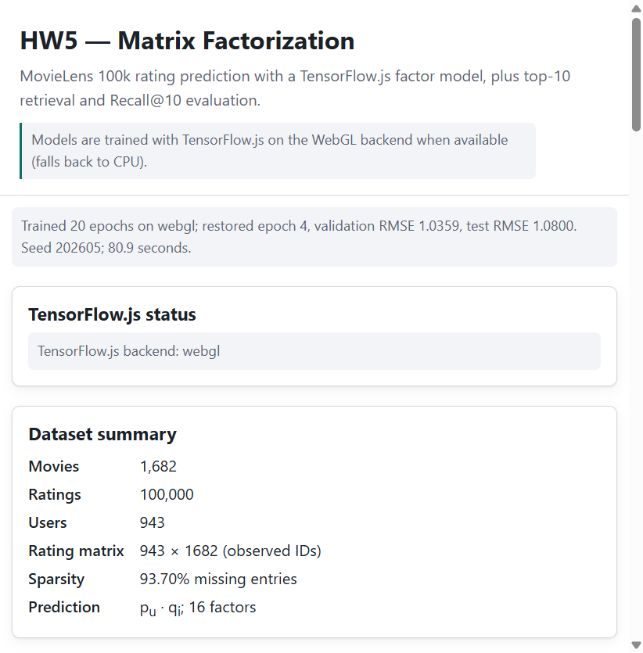
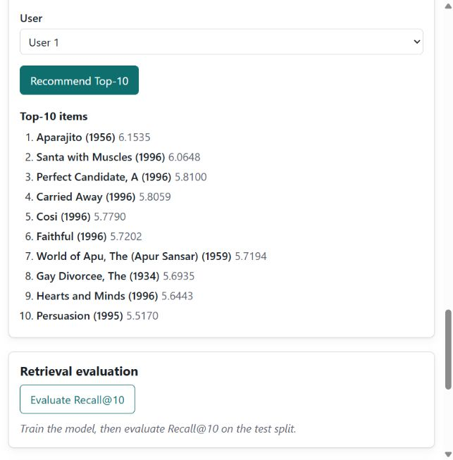
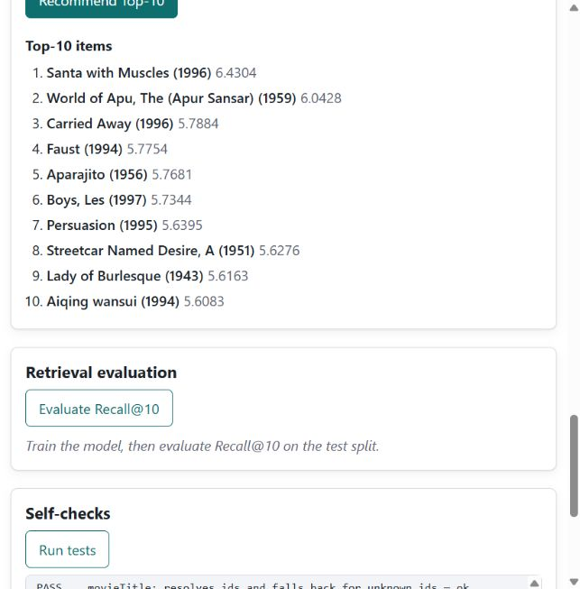
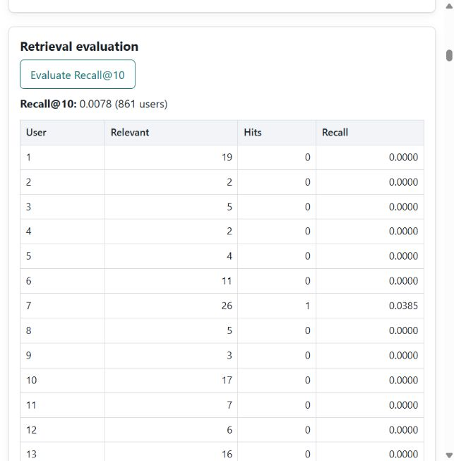

# HW5: From Ratings to Recommendations
**Author:** Petr Vorozhtsov
**Course:** LLM4RecSys, HSE University, 14 October 2026

## Abstract
This homework implements the supplied JavaScript matrix-factorization application on MovieLens 100K. The principal model follows the lecture: 16-dimensional user and movie vectors predict ratings through their dot product. The selected validation checkpoint improves rating RMSE, but full-pool Recall@10 is weak. The analysis distinguishes new titles from broader genre discovery and reports starter-test inconsistencies honestly.

## I. Task and provenance
The final lecture slide requires data counts and sparsity, per-user chronological 80/10/10 splitting, a training-mean baseline, 16D matrix factorization, validation checkpoint selection, test RMSE, two Top-10 lists, macro Recall@10, and an analysis of familiar choices versus discovery.

The exact Week 5 starter was taken from upstream commit 00c032fb58ca5f7bec05218b5bebee01e462e532. The student's original Week 5 folder contained an obsolete PageRank demo; the actual provided matrix-factorization starter was used. The supplied data are unchanged and byte-identical to Weeks 2 and 3. Only title decoding was corrected to preserve Latin-1 accents.

[Published implementation](https://github.com/PetrVorozhtsov/RecSys-LLMs/tree/0066ff4776dd5ec32f90cd9bfb282b108f4daa31/week5). The implementation commit was verified on the remote main branch. The [public demonstration](https://petrvorozhtsov.github.io/RecSys-LLMs/week5/) was deployed successfully from main. The public page loaded MovieLens on WebGL with the expected counts. The training screenshots and measured model results in this report are from the same implementation served locally over HTTP.

## II. Data and evaluation protocol
There are 100,000 unique user/movie ratings, 943 users and 1,682 movies. No malformed rows or duplicate pairs were found. The actual matrix has 1,586,126 cells and 93.6953306358% missing entries. Unused zero-index padding in the allocated arrays is excluded from this denominator. Missing ratings are unobserved and never used as zero-valued training targets.

Ratings are sorted separately for each user by timestamp, then movie ID to break ties. Training uses floor(0.8*n), validation floor(0.1*n), and test the remainder. No users are excluded by the supplied minimum-five-ratings rule.

| Split | Raw ratings | RMSE eligible | Excluded |
|---|---:|---:|---:|
| Train | 79,619 | 79,619 | 0 |
| Validation | 9,596 | 9,561 | 35 |
| Test | 10,785 | 10,732 | 53 |

RMSE excludes rows whose user or movie does not occur in training. There are no unseen users; validation excludes 32 distinct movies and test excludes 46. Both the baseline and MF use the same eligible rows. The training mean is 285,084 / 79,619 = 3.5806026199776437; neither validation nor test targets enter this mean.

Retrieval candidates are the 1,611 movies observed anywhere in training, minus the current user's training and validation movies. Test ratings >=4 are relevant. Of 5,155 relevant rows, 5,142 are eligible. Thirteen distinct unseen relevant movies and 82 users without eligible relevant movies are excluded, leaving 861 evaluable users. Recall is the unweighted mean of each user's hits / eligible relevant movies.

## III. Implementation
The six supplied functions are implemented in script.js: predictRating, initializeFactors, trainMF, selectBestCheckpoint, recommendTopK and recallAtK. TensorFlow.js variables hold 16D factors, initialized with seeded small normal values. Gather, multiplication, summation and matrix multiplication score batches; tf.topk produces rankings.

Adam minimizes the observed-rating mean squared error plus 0.05 times the batch mean of squared user/item factor norms. Default training uses 20 epochs, learning rate 0.01, batch size 64 and seed 202605. Browser training yields between batches. Intermediate tensors and the optimizer are disposed; repeated initialization replaces the old variables.

The actual user and item weights at each new minimum validation RMSE are saved and restored after training. Checkpoint ties retain the earliest epoch. The principal prediction is p dot q, without a mean offset or clipping; the training mean is only a baseline and an unknown-ID fallback. Consequently raw scores can exceed the 1-5 rating scale. They are not watch probabilities.
## IV. Measured results
The principal browser run used the WebGL backend and the supplied default hyperparameters. It trained for 80.9 seconds and selected epoch 4 of 20. The final epoch's validation RMSE was worse; the selected weights were restored before test evaluation.

| Measure | Value | Dataset | Basis |
|---|---:|---|---|
| Selected train RMSE | 0.866298 | Train | 79,619 rows |
| Selected validation RMSE | 1.035942 | Validation | 9,561 rows |
| Baseline test RMSE | 1.225719 | Test | 10,732 rows |
| MF test RMSE | 1.080030 | Test | Same rows |
| Macro Recall@10 | 0.00777656 | Test | 861 users |

MF lowers eligible-test RMSE by 11.89%. Macro Recall@10 is only 0.7777%, with 51 hits among 5,142 eligible relevant movies. The ratio 51/5,142 is a micro-average and is not the reported macro metric. This weak retrieval result does not justify a deployment claim based on RMSE alone.

A second browser configuration was run only as a functional smoke test: two epochs, learning rate 0.005, batch size 128, the same regularization and seed. Its validation RMSE was 1.005403 and test RMSE 1.031832. It was not substituted for the assignment's default-run result or selected using the test set.

## V. Verification and starter conflicts
Previously completed original self-checks: 4 PASS, 0 FAIL, 7 PENDING before implementation; 8 PASS, 3 FAIL, 0 PENDING after implementation. The original fixtures and assertions are preserved. The three failures are incompatible starter requirements: the prediction test expects clipping of a dot product equal to 11; a recommendation fixture expects a movie never observed in training; and the rank-11 recall fixture trains only movies 1, 2 and 3, so relevant movie 2 necessarily fits inside Top-10 after excluding movie 1.

The lecture-correct implementation is therefore not reported as passing all original tests. Eleven separate meaningful contract checks passed, with zero failures and zero skips. They cover literal dot products, identical cold-start exclusions, the global training pool, macro averaging, actual checkpoint-weight restoration, repeated-training tensor lifetime and invalid-parameter guards. These checks supplement the original harness.

Independent Python/NumPy code parsed and split the source data and recomputed all selected-model metrics and full candidate rankings without importing application JavaScript or TensorFlow. Test RMSE was 1.080029641342, versus browser 1.080029726237; absolute difference 8.49e-08. All 861 per-user hit/relevant counts and both Top-10 rankings matched.

The independent baseline uses RMSE = sqrt((sum(r^2) - 2*mu*sum(r) + N*mu^2)/N). For eligible test: N=10,732, sum(r)=35,683, sum(r^2)=134,065 and mu=285,084/79,619; result 1.2257193843347933. The original all-row baseline 1.2289001371836488 has a different denominator and is not used for the primary comparison.

For user 196, movie 411, the independent sum of 16 factor products is 3.179783462789; the browser returns 3.179783582687. The actual rating is 4 and squared error is 0.672755167914. Full factor vectors are retained in evidence/browser-run.json.

The real browser was also used to verify pre-training empty states, both user selectors, alternate hyperparameters, a rejected negative learning rate and an isolated missing-data HTTP 404 case. No new verification was performed during this accelerated report-generation step.

## VI. Familiar choices versus new discoveries
Users 1 and 2 were selected from their training-plus-validation histories before examining recommendations or test outcomes. User 1 has 244 past ratings, including 144 rated >=4; user 2 has 55 past ratings, including 38 rated >=4. Movie genre flags are multi-label, so genre proportions need not sum to 100%.

### A. User 1: Top-10
| Rank | Movie title | Raw score |
|---:|---|---:|
| 1 | Aparajito (1956) | 6.1535 |
| 2 | Santa with Muscles (1996) | 6.0648 |
| 3 | Perfect Candidate, A (1996) | 5.8100 |
| 4 | Carried Away (1996) | 5.8059 |
| 5 | Cosi (1996) | 5.7790 |
| 6 | Faithful (1996) | 5.7202 |
| 7 | World of Apu, The (Apur Sansar) (1959) | 5.7194 |
| 8 | Gay Divorcee, The (1934) | 5.6935 |
| 9 | Hearts and Minds (1996) | 5.6443 |
| 10 | Persuasion (1995) | 5.5170 |

Past ratings include Jurassic Park (5/5; Action, Adventure, Sci-Fi), Usual Suspects (5/5; Crime, Thriller), Remains of the Day (5/5; Drama) and French Twist (5/5; Comedy, Romance). In the past, Drama appears in 93/244 movies (38.1%), Action in 69/244 (28.3%), and Sci-Fi in 37/244 (15.2%).

The Top-10 contains four Drama, four Comedy and three Romance flags, but no Action or Sci-Fi. Aparajito and World of Apu introduce unseen titles within familiar Drama; Persuasion is a familiar Romance choice. Perfect Candidate is a less common Documentary title, but Documentary already appears in four past movies. All ten titles are new relative to training/validation, yet zero recommendations introduce a previously unseen genre. The list supports catalogue discovery within a narrow portion of the known profile, rather than broad genre exploration. It hits none of this user's 19 eligible relevant test movies.

### B. User 2: Top-10
| Rank | Movie title | Raw score |
|---:|---|---:|
| 1 | Santa with Muscles (1996) | 6.4304 |
| 2 | World of Apu, The (Apur Sansar) (1959) | 6.0428 |
| 3 | Carried Away (1996) | 5.7884 |
| 4 | Faust (1994) | 5.7754 |
| 5 | Aparajito (1956) | 5.7681 |
| 6 | Boys, Les (1997) | 5.7344 |
| 7 | Persuasion (1995) | 5.6395 |
| 8 | Streetcar Named Desire, A (1951) | 5.6276 |
| 9 | Lady of Burlesque (1943) | 5.6163 |
| 10 | Aiqing wansui (1994) | 5.6083 |

User 2 previously rated Good Will Hunting, Fargo, Emma and Wings of the Dove 5/5. Drama appears in 32/55 past movies (58.2%), Romance in 16/55 (29.1%), and Action in 8/55 (14.5%). Toy Story is the one historical Animation movie, rated 4/5.

The list contains five Drama, three Comedy and two Romance flags. World of Apu, Streetcar Named Desire and Carried Away mainly extend familiar Drama/Romance preferences. Faust offers an unfamiliar Animation title, but Animation is not a new genre for this user. All ten titles are unseen in training/validation, with zero newly introduced genres. None hits this user's two eligible relevant test movies.

### C. Value and limits for a streaming platform
Novel catalogue exposure could help viewers find older, foreign-language or less frequently rated titles within genres they already enjoy. However, unseen in the rating log is not proof the viewer has never watched a title. Nor does a new title prove useful novelty or satisfaction.

The extreme scores are poorly supported. Santa with Muscles, recommended to both users, has only two training ratings. Lady of Burlesque and Aiqing wansui each have one; Aparajito has five and World of Apu six. Five recommended films overlap between these users. Such recommendations may reflect sparse-data overconfidence rather than strong personalization. User 1's Action/Sci-Fi interests are underrepresented, and the very low full-pool recall reinforces the concern.

The implementation demonstrates rating prediction and title discovery, but these results do not support launching it as the sole production retrieval policy. A platform should first compare ranking-focused and popularity baselines on a fixed validation protocol, evaluate calibrated scores and exposure concentration, and then use a controlled online study of watch starts, completed viewing and retention. No causal uplift, revenue or profit is estimated here.

## VII. Reproducibility, limitations and AI disclosure
Serve the repository over HTTP with python -m http.server 8000 and open /week5/. The page loads the pinned TF.js CDN runtime, shows its backend and supports training, recommendations, recall and full run export. Data-audit, verification and independent-model JSON files accompany this report. The saved selected factors reproduce the reported results despite possible small CPU/GPU floating-point differences.

The starter's cited docs/homework-guidelines/guidelines.md was absent from the upstream tree. This document uses an IEEE-inspired two-column format without claiming compliance with unavailable detailed guidelines. GitHub Pages hosting is enabled and the deployment succeeded. The original journal is a raw Codex JSONL file supplied separately; it is not published in the public GitHub repository. The starter's OpenCode session.json export command is not applicable to Codex, so no fabricated replacement was created.

Codex implemented the functions, ran the browser and automated checks, performed independent calculations and drafted this report. Personal verification by Petr Vorozhtsov is not claimed. Ratings are historical observational data with incomplete exposure information; low recall and sparse-film overconfidence limit business conclusions. The per-user temporal split is not a globally synchronized production-time experiment.

## References
[1] Seungmin Jin. Matrix Factorization & Two Tower, LLM4RecSys lecture 05, HSE University, supplied lecture PDF, final slide: HW5. From Ratings to Recommendations.

[2] [Pinned Week 5 starter](https://github.com/dryjins/RecSys-LLMs/tree/00c032fb58ca5f7bec05218b5bebee01e462e532/week5), commit 00c032fb58ca5f7bec05218b5bebee01e462e532. Actual code and all original self-checks were inspected.

[3] GroupLens, [MovieLens 100K release](https://grouplens.org/datasets/movielens/100k/) and [authoritative dataset README](https://files.grouplens.org/datasets/movielens/ml-100k-README.txt). Exact dimensions and data fields were checked in the README rather than the rounded landing-page summary.

[4] F. Maxwell Harper and Joseph A. Konstan. The MovieLens Datasets: History and Context. ACM Transactions on Interactive Intelligent Systems, vol. 5, no. 4, Article 19, 19 pages, 2015. [DOI 10.1145/2827872](https://doi.org/10.1145/2827872). Citation verified against the primary GroupLens README; no claim is made to have reviewed the entire paper.

[5] TensorFlow.js, [version 4.22.0 API](https://js.tensorflow.org/api/4.22.0/). Tensor operations, optimizer and memory-management APIs were checked against official documentation.

<!-- evidence-pages -->
## Appendix: real browser evidence

<!-- page-break -->

<!-- page-break -->

<!-- page-break -->

